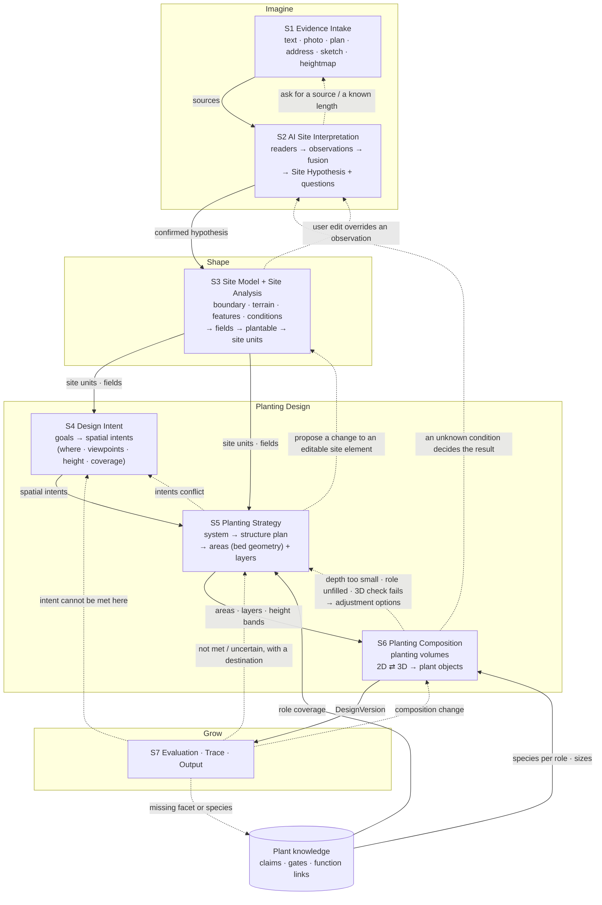
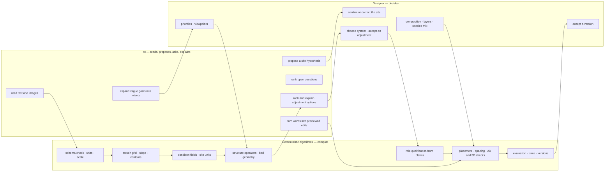
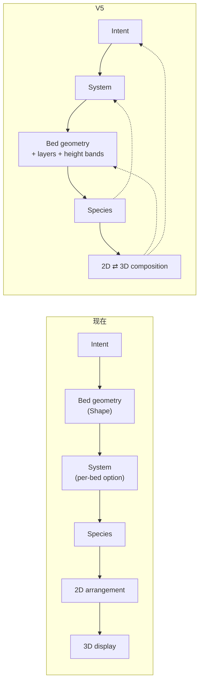
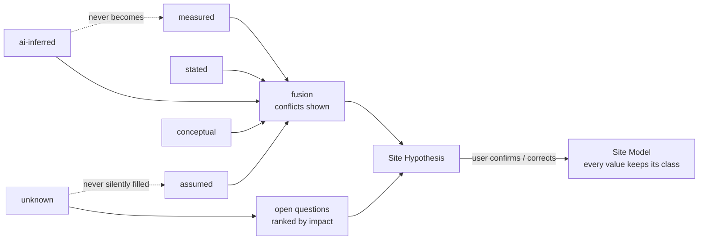

# Workflow V5 — 流程图

对应 [WORKFLOW-V5.md](WORKFLOW-V5.md)。图用 Mermaid 写成，在 GitHub 上直接显示。
实线 = 数据向下传递；虚线 = 回馈到前面的步骤。

## 1. 主流程与回馈

## 2. 谁做什么

AI 的任何输出在进入模型之前都经过 D1 的校验，或经过用户确认。AI 不写米制几何，不选物种，不落点，不改评价数值。

## 3. 现状与 V5 的顺序差别

## 4. 证据等级的流动

